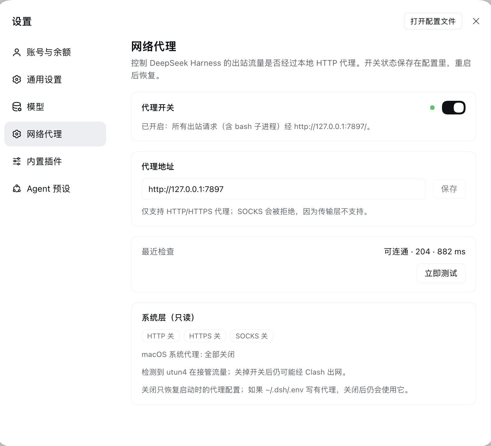
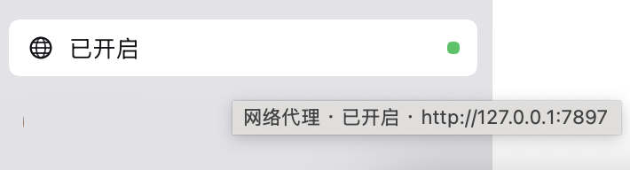

# dsh-plugin-proxy-toggle

<p align="center">
  
</p>

<p align="center">
  
</p>

<p align="center">
  <b>DeepSeek Harness 桌面插件的出站代理开关</b><br>
  <em>侧边栏一键切换 · Google 204 连通测试 · 系统层只读提示 · 不改 Clash、不改系统设置</em>
</p>

<p align="center">
  <a href="LICENSE"></a>
  <a href="https://github.com/WosLovesLife/dsh-plugin-proxy-toggle/commits/main"></a>
  <a href="https://github.com/WosLovesLife/dsh-plugin-proxy-toggle/actions"></a>
</p>

中文 | [English](#english)

## 中文

### 是什么

一个装进 DeepSeek Harness **桌面版**（DSH Desktop）的小插件：在侧边栏底部加一个代理开关，一键让 Harness 的出站流量在“启动时的网络策略”和“本地 HTTP 代理”之间切换。它只改 Harness 自己的进程内路由，**不修改 Clash 配置、不打开 macOS 系统代理、不动 TUN**。

### 功能

- **侧边栏开关**：单击直接开/关，圆点表示空闲 / 连接中 / 可用 / 失败。
- **设置页**：同一个开关、代理地址编辑、手动测试、最近一次检查结果。
- **作用范围**：所有出站 `fetch`（`web_fetch`、模型请求、HTTP MCP），以及之后启动的子进程（`bash` 里的 `curl`、`git`、`pnpm` 等）。
- **状态持久化**：开关与地址写进插件自己的 profile 配置，DSH 重启后自动恢复。
- **系统层提示**：只读展示 macOS 系统代理与 TUN 路由；发现 `utun` 在接管流量时会明确提醒“关闭开关不等于真直连”。

### 安装

需要 DeepSeek Harness **Desktop**（Electron）。安装任选一种：

1. 侧边栏 **Plugins** 页面安装外部 bundle，填入仓库地址：
   `https://github.com/WosLovesLife/dsh-plugin-proxy-toggle`
2. 在对话里让 agent 用 `plugin_manager` 的 `install_bundle` 安装同一地址或本地 clone 路径。
3. CLI 可用时：`dsh plugin add https://github.com/WosLovesLife/dsh-plugin-proxy-toggle`

安装后刷新页面（⌘R / Ctrl+R），侧边栏底部应出现地球图标按钮。

### 使用

- **开 / 关**：点侧边栏按钮，或设置 →「网络代理」里的开关。
- **改地址**：设置 →「网络代理」→ 代理地址，默认 `http://127.0.0.1:7897`（Clash 的 Mixed 端口）。
- **测试**：点「立即测试」，或每次开启时自动测。

### 连通测试测什么

开启代理、修改地址或点「立即测试」时，插件会**通过刚装上的代理**请求：

```
GET https://www.google.com/generate_204
```

10 秒超时、失败重试一次、不带 cookie 与凭据，`user-agent: dsh-proxy-toggle/1.0`。Google 在国内直连不通，所以拿到 204 才能证明请求确实走了代理，而不是悄悄回落直连。代价是这个端点不返回出口 IP 与地区，页面只显示“可连通 · 204 · 延迟”。

测试失败时，开关保持开启并标红，同时显示底层错误（例如 `connect ECONNREFUSED 127.0.0.1:7898`），不会静默切回直连。

### “关闭”到底意味着什么

关闭会撤销插件装的代理层，恢复到**启动时**的 dispatcher 与代理环境变量。也就是说：

- 如果 `~/.dsh/.env` 里写了代理，关闭后 Harness 仍会使用它；
- 如果 Clash 开着 TUN，关闭后流量仍可能在 IP 层被接管。

设置页会如实标注这两点，不会把“关闭”说成“真直连”。

### 兼容性

- 实测环境：**DSH Desktop 0.2.2-rc.1（macOS）**。
- 插件通过 `process.resourcesPath/app.asar/dsh/node_modules` 加载宿主自带的 `dsh-http-proxy` 与 `undici`，以保证与启动器共享同一份策略与 dispatcher。因此**源码运行或 npm CLI 安装的 DSH 不在支持范围内**，换了 DSH 版本也可能因内部路径变化而失效。
- Windows/Linux 的 Desktop 未实测；系统层提示用到的 `scutil` / `netstat` 是 macOS 专用，缺失时只是不显示该项。

### 隐私与安全

- 只在开启代理或点「立即测试」时访问 `google.com`；不发送 cookie、凭据或 Harness 数据。
- 系统代理与路由信息只在本机读取（`scutil --proxy`、`netstat -rn`），不上传。
- 插件注册的两个本地 HTTP 端点只接受 owner 连接；不修改系统代理、TUN 或 Clash 配置。
- 代理地址会以明文保存在 DSH profile 配置里；如地址包含账号密码，请注意 profile 文件的访问权限。

### 已知限制

- 只支持 HTTP/HTTPS 代理；`socks5://` 会被传输层拒绝。
- 不显示出口 IP / 地区（Google 204 没有这些信息）。
- 已有子进程不会回溯更新环境，只有之后启动的子进程继承新的代理变量。
- 每个 DSH profile 各自保存开关状态。

### 开发

```sh
git clone https://github.com/WosLovesLife/dsh-plugin-proxy-toggle
node scripts/check-manifest.mjs
```

代码结构：

- `index.js`：Host 半体。用 `installProxyFromEnvironment` 在启动器策略之上叠一层代理，写入/恢复代理环境变量，注册 `/plugin/proxy-toggle/{state,action}` 两个本地端点，并做 Google 探针与系统层读取。
- `client.js`：Client 半体。注册侧边栏按钮与设置页，通过本地端点读取同一份状态，5 秒轮询。
- `cordis.patch.yml`：插入 `proxy-toggle` 这一行；开关与地址是这一行的 volatile 配置字段，因此改动即时生效且可持久化。

## English

A small **DeepSeek Harness Desktop** plugin that puts a proxy switch in the sidebar and a settings page behind it. It changes only the Harness process's own outbound path: every `fetch` (web fetch, model requests, HTTP MCP) and the proxy environment inherited by newly spawned children. It never edits Clash, the macOS system proxy, or TUN.

### Features

- Sidebar switch: one click toggles the proxy; the dot shows idle, connecting, reachable, or failing.
- Settings page: the same switch, the proxy address, a manual test, and the last check result.
- Persistence: the switch and address live in the plugin's profile row and survive a restart.
- Read-only system card: macOS system proxy and TUN route state, with a warning that "off" is not a direct connection while TUN is active.

### Install

Requires DeepSeek Harness **Desktop** (Electron). Install the bundle from the sidebar **Plugins** page, or tell the agent to run `plugin_manager` `install_bundle` with:

```
https://github.com/WosLovesLife/dsh-plugin-proxy-toggle
```

With the CLI available: `dsh plugin add https://github.com/WosLovesLife/dsh-plugin-proxy-toggle`. Refresh the page afterwards.

### Probe

When the switch turns on, the address changes, or "Test now" is pressed, the plugin sends `GET https://www.google.com/generate_204` **through the installed proxy** (10 s timeout, one retry, no cookies, fixed user agent). Google is unreachable on a direct connection in mainland China, so a 204 proves the request really used the proxy. A failure keeps the switch on and shows the transport error instead of silently reverting.

### Compatibility

Tested with **DSH Desktop 0.2.2-rc.1 on macOS**. The Host half loads `dsh-http-proxy` and `undici` from `app.asar` so it shares the launcher's policy and dispatcher; source checkouts and npm CLI installs are unsupported, and other DSH versions may move these internal paths.

### Privacy

The plugin contacts `google.com` only while the proxy is on or a test is requested. System proxy and route state is read locally, never uploaded. The two local HTTP routes accept owner connections only and never modify system or Clash settings.

## License

[MIT](LICENSE) © 2026 WosLovesLife
